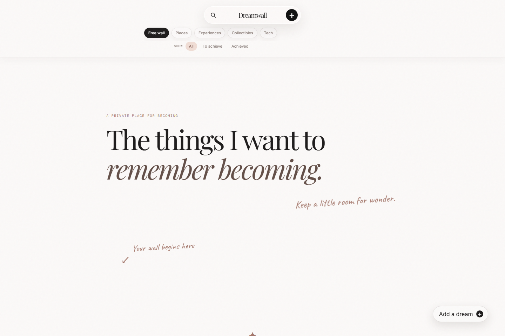
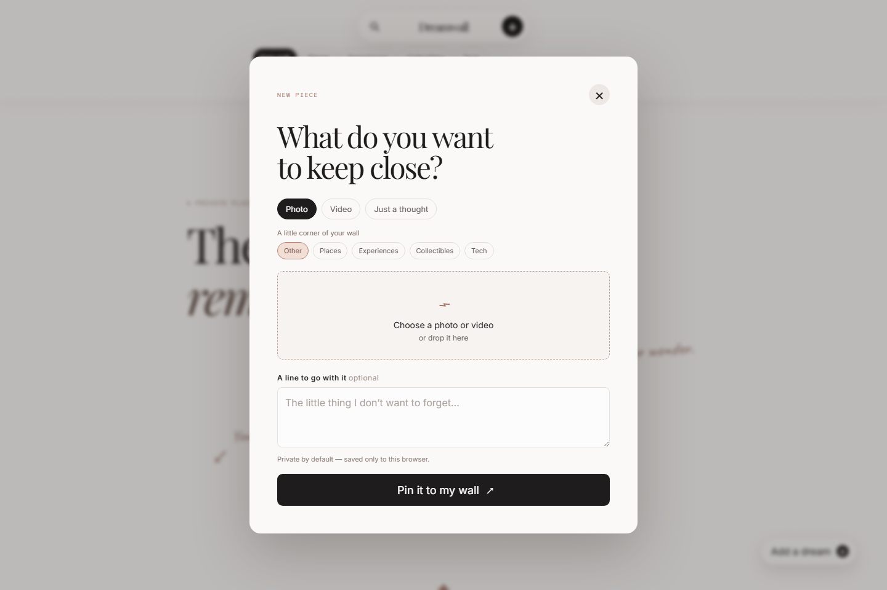
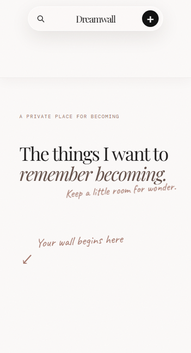

<div align="center">

# Dreamwall

**A private, local-first digital dream board for the places, experiences, objects and ideas worth working toward.**


</div>

Dreamwall is an experimental personal-product concept: part scrapbook, part vision board, and deliberately not a productivity dashboard. It uses an editorial, freeform wall rather than a rigid card grid, so each dream feels more like a memory or a pinned keepsake.

## Preview

<p align="center">
  
  <br/><sub><b>Desktop wall</b></sub>
</p>

<table>
<tr>
<td width="62%" align="center" valign="top">
  
  <br/><sub><b>Add a dream</b></sub>
</td>
<td width="38%" align="center" valign="top">
  
  <br/><sub><b>Mobile layout</b></sub>
</td>
</tr>
</table>

## Why I built it

I am an MBA student exploring how product thinking, design judgment and AI-assisted development can turn an idea into a usable digital experience. Dreamwall is a hobby project and a practical experiment in defining a product direction, iterating from visual references, and working confidently with modern web code alongside AI.

## What it demonstrates

- Product concept development from an initial visual prototype
- A deliberately non-standard, editorial interface for a personal-use product
- AI-assisted frontend development and iterative debugging
- Local-first thinking for private personal content
- Clear UX decisions around content creation, editing, filtering and achievement tracking

## Features

| | |
| :-- | :-- |
| 🖼️ **Capture** | Add photos, videos or text-only thoughts, each with a short personal caption |
| ✂️ **Compose** | Choose a portrait, square or wide crop, then move and zoom the focal point so the saved wall matches the preview |
| 🗂️ **Organise** | Sort entries into Places, Experiences, Collectibles, Tech or Other |
| 🔍 **Find** | Start on the free wall, then filter by category and status, or search |
| 🏅 **Achieve** | Mark a dream as achieved with an on-image achievement stamp |
| ✏️ **Manage** | Edit captions, review creation time or remove an item |
| 🔒 **Own your data** | All entries and uploaded media stay in the current browser profile |

## Built with

- Semantic HTML
- Modern CSS, including responsive layouts and custom visual treatments
- Vanilla JavaScript
- IndexedDB for local browser storage
- Google Fonts: Playfair Display, Inter, Caveat and DM Mono

## Run locally

Open `index.html` in a modern browser. For the most reliable local-storage behaviour, serve the folder with a small local web server:

```bash
python -m http.server 8080
```

Then visit `http://localhost:8080`.

## Privacy

Dreamwall has no account, server, analytics or cloud sync. Photos, videos and entries remain in IndexedDB within the browser profile where they were added. Clearing browser site data, changing browsers or switching devices removes access to that local wall.

This repository contains the application source code only. No personal entries or uploaded media are committed.

## Roadmap

- [ ] Backup and export tools
- [ ] A more personalised opening message
- [ ] A private hosted version for personal use

---

<div align="center">
<sub>Built by <a href="https://github.com/parvnar">Parv Nar</a></sub>
</div>
